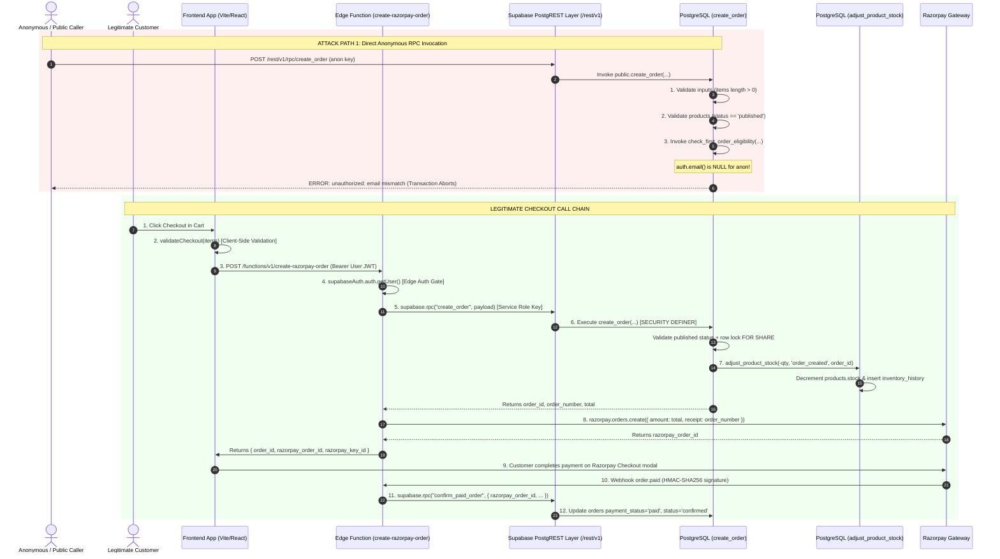

# HOP — Security Audit Report: Anonymous Order Creation & Inventory Reservation

**Target Project:** Supabase Production `kbvjmcnaaogkbnerjcoc` (Mumbai `ap-south-1`)  
**Audit Scope:** Read-Only Security Review — Anonymous Order Creation, Inventory Reservation, and Checkout Authorization  
**Inspection Timestamp:** 2026-10-25 23:35:00 IST (2026-10-25 18:05:00 UTC)  
**Auditor:** HOP Principal Security & DevOps Engineer  
**Mode:** Strictly Read-Only (Zero Production Mutations, Zero Test Purchases, Zero Secret Disclosures)  

---

## 1. Executive Verdict

### **VERDICT: PASS WITH FINDINGS**

```
┌─────────────────────────────────────────────────────────────┬─────────────────┐
│ Threat Vector                                               │ Status          │
├─────────────────────────────────────────────────────────────┼─────────────────┤
│ Anonymous Direct Order Creation via RPC                     │ BLOCKED (PASS)  │
│ Anonymous Stock Decrement via adjust_product_stock          │ BLOCKED (PASS)  │
│ Price & Quantity Client-Side Tampering                      │ BLOCKED (PASS)  │
│ Customer PII & Order Data Exposure                          │ BLOCKED (PASS)  │
│ Direct Payment Confirmation Bypass (confirm_paid_order)     │ VULNERABLE (⚠️) │
│ Uncontrolled Inventory Holding / Abandoned Checkout Lock    │ VULNERABLE (⚠️) │
│ Unrestricted Admin RPCs (release_order_inventory, etc.)    │ VULNERABLE (⚠️) │
│ Edge Function Order Creation Failure (service_role context) │ BROKEN (🚨)     │
└─────────────────────────────────────────────────────────────┴─────────────────┘
```

### Executive Summary
1. **Core Attack Surface (Anonymous Order Creation & Inventory Decrement) is Resilient:**  
   An unauthenticated public caller **cannot** create unpaid orders, cannot decrement product stock, and cannot manipulate prices, quantities, shipping fees, or deposits. Even though `public.create_order(...)` retains an explicit `GRANT EXECUTE ... TO anon`, any anonymous call is rejected with `unauthorized: email mismatch` by `check_first_order_eligibility` and with `Access denied. Administrator privileges required.` by `adjust_product_stock`, forcing an atomic transaction rollback. Furthermore, all products in production are currently in `draft` or `review`, triggering immediate abort via `product_not_available`.
2. **Critical Privilege Separation Findings Identified:**  
   PostgreSQL system catalog audits revealed that several sensitive `SECURITY DEFINER` RPCs (`confirm_paid_order`, `release_order_inventory`, `refund_deposit`, and `mark_delivery_paid_rpc`) retain default `PUBLIC` and `anon` execution privileges and lack internal caller authorization checks. Specifically, an attacker who initiates a legitimate checkout session and obtains a `razorpay_order_id` could call `confirm_paid_order` directly via PostgREST RPC to mark their order as `paid` and `confirmed` without paying.
3. **Operational Edge Function Blocker Identified:**  
   The `create-razorpay-order` Edge Function calls `create_order` using the Supabase `service_role` key. Because `create_order` unconditionally calls `check_first_order_eligibility`, and `check_first_order_eligibility` requires `auth.email() IS NOT NULL`, requests from the Edge Function fail because the service-role JWT has no email claim.

---

## 2. Production Metadata & Function Inventory

All data extracted directly from PostgreSQL system catalogs (`pg_proc`, `pg_namespace`, `pg_roles`, `pg_tables`, and `pg_policies`) on `kbvjmcnaaogkbnerjcoc`:

| Function Name | OID | Security Mode | Owner | Search Path | Effective ACL | RPC Exposed? | Direct Anon Execution? |
| :--- | :---: | :---: | :---: | :---: | :--- | :---: | :---: |
| **`public.create_order`** | `42305` | `SECURITY DEFINER` | `postgres` | `public` | `{postgres=X/postgres,anon=X/postgres,authenticated=X/postgres,service_role=X/postgres}` | Yes | **Rejected at runtime** (`email mismatch`) |
| **`public.adjust_product_stock`** | `42398` | `SECURITY DEFINER` | `postgres` | `public` | `{postgres=X/postgres,authenticated=X/postgres,service_role=X/postgres}` | Yes (Auth only) | **Blocked** (No anon grant; 42501 in body) |
| **`public.confirm_paid_order`** | `18396` | `SECURITY DEFINER` | `postgres` | `public` | `{=X/postgres,postgres=X/postgres,anon=X/postgres,authenticated=X/postgres,service_role=X/postgres}` | Yes | **Callable** (Lacks role check; has `=X`) |
| **`public.release_order_inventory`**| `18398` | `SECURITY DEFINER` | `postgres` | `public` | `{=X/postgres,postgres=X/postgres,anon=X/postgres,authenticated=X/postgres,service_role=X/postgres}` | Yes | **Callable** (Lacks role check; has `=X`) |
| **`public.refund_deposit`** | `18400` | `SECURITY DEFINER` | `postgres` | `public` | `{=X/postgres,postgres=X/postgres,anon=X/postgres,authenticated=X/postgres,service_role=X/postgres}` | Yes | **Callable** (Lacks role check; has `=X`) |
| **`public.mark_delivery_paid_rpc`** | `18401` | `SECURITY DEFINER` | `postgres` | `public` | `{=X/postgres,postgres=X/postgres,anon=X/postgres,authenticated=X/postgres,service_role=X/postgres}` | Yes | **Callable** (Lacks role check; has `=X`) |
| **`public.check_first_order_eligibility`** | `42314` | `SECURITY DEFINER` | `postgres` | `public` | `{=X/postgres,postgres=X/postgres,anon=X/postgres,authenticated=X/postgres,service_role=X/postgres}` | Yes | **Rejected** (`auth.email() IS NULL`) |
| **`public.check_cross_account_abuse`** | `42315` | `SECURITY DEFINER` | `postgres` | `public` | `{=X/postgres,postgres=X/postgres,anon=X/postgres,authenticated=X/postgres,service_role=X/postgres}` | Yes | Callable (Read-only check) |
| **`public.generate_order_number`** | `17905` | `SECURITY INVOKER` | `postgres` | *Inherited* | `{=X/postgres,postgres=X/postgres,anon=X/postgres,authenticated=X/postgres,service_role=X/postgres}` | Yes | Callable (Generates formatted string) |

> [!NOTE]
> **PostgreSQL ACL Legend:**  
> - `=X/postgres`: Execution privilege granted to the pseudo-role `PUBLIC` (every database role inherits this).
> - `anon=X/postgres`: Explicit execution privilege granted to the unauthenticated Supabase REST role (`anon`).
> - `authenticated=X/postgres`: Explicit execution privilege granted to logged-in users (`authenticated`).
> - `service_role=X/postgres`: Explicit execution privilege granted to server-side Edge Functions.

---

## 3. Browser-to-Database Checkout Call Chain



---

## 4. Threat & Abuse Scenario Analysis

### A. Anonymous Order Creation
- **Attack Vector:** An unauthenticated user sends a raw HTTP POST request to `https://kbvjmcnaaogkbnerjcoc.supabase.co/rest/v1/rpc/create_order` with `apikey: <anon_key>` and `Authorization: Bearer <anon_key>`.
- **Observed Database Reality:**
  - `anon` role possesses PostgreSQL `EXECUTE` privilege on `create_order` (OID `42305`).
  - Execution commences inside `create_order`.
  - In Step 2, `SELECT ... WHERE id = v_product_id FOR SHARE` checks `p.status = 'published'`. In current production state, all products are in `draft` or `review`, so execution aborts with `product_not_available`.
  - If a product were published in the future, execution proceeds to Step 3:
    `v_eligibility := check_first_order_eligibility(p_customer_email, p_customer_phone);`
  - In `check_first_order_eligibility` ([lines 84–87 of `20260928000004_first_order_benefit.sql`](file:///E:/HOP/supabase/migrations/20260928000004_first_order_benefit.sql#L84-L87)):
    ```sql
    IF auth.email() IS NULL OR auth.email() != p_customer_email THEN
      RAISE EXCEPTION 'unauthorized: email mismatch';
    END IF;
    ```
  - For an `anon` caller, `auth.email()` is `NULL`. The function raises `'unauthorized: email mismatch'`.
  - In Step 6, `adjust_product_stock` ([lines 33–36 of `20261004000000_studio_production_remediation.sql`](file:///E:/HOP/supabase/migrations/20261004000000_studio_production_remediation.sql#L33-L36)) additionally enforces:
    ```sql
    IF (auth.role() = 'authenticated' AND NOT public.is_admin()) OR auth.role() = 'anon' THEN
      RAISE EXCEPTION 'Access denied. Administrator privileges required.' USING ERRCODE = '42501';
    END IF;
    ```
- **Finding:** **CONFIRMED BLOCKED.** Anonymous callers cannot create orders. Any direct RPC call fails and rolls back atomically.

---

### B. Authenticated Direct RPC Invocation (Bypassing Edge Function)
- **Attack Vector:** An attacker registers a free account, obtains an `authenticated` JWT, and calls `POST /rest/v1/rpc/create_order` directly to bypass the Edge Function, passing their own email (`p_customer_email = auth.email()`).
- **Observed Database Reality:**
  - `check_first_order_eligibility` matches `auth.email() == p_customer_email` and passes.
  - `customers`, `shipping_addresses`, `orders`, and `order_items` records are prepared inside the transaction.
  - At line 204 of `create_order`, the function calls `adjust_product_stock(...)`.
  - `adjust_product_stock` executes with `auth.role() = 'authenticated'`.
  - Because the attacker is not an admin (`NOT public.is_admin()`), line 33 of `adjust_product_stock` evaluates to `true` and raises `Access denied. Administrator privileges required. (42501)`.
  - PostgreSQL immediately rolls back the entire transaction.
- **Finding:** **CONFIRMED BLOCKED.** Authenticated non-admin users cannot create orders directly via PostgREST RPC.

---

### C. Price, Quantity, Shipping, and Deposit Integrity
- **Attack Vector:** An attacker tampers with JSON payloads sent to checkout to alter prices, request fractional or negative quantities, or zero-out shipping.
- **Observed Database Reality:**
  - **Prices:** Fully server-authoritative. Lines 104–106 and 137–142 of `20261025012500_safeguard_create_order_require_published_products.sql` query `selling_price` directly from `public.products`. Client prices are discarded.
  - **Quantities:** Lines 52–57 strictly enforce `(quantity)::INTEGER > 0`. Zero, negative, or malformed quantities abort with `invalid_order_items`.
  - **Shipping Fees:** Lines 111–122 calculate shipping strictly from `settings.store_settings` or fixed constants (`20000` paise). Client inputs are discarded.
  - **Deposits:** Lines 126–133 require deposits to equal exactly `20000` paise (₹200.00) and order totals to exceed `20000` paise.
- **Finding:** **CONFIRMED VERIFIED.** The server does not trust client financial calculations.

---

### D. Inventory Reservation & Stock Exhaustion (Holding Attack)
- **Attack Vector:** A user initiates repeated orders through `create-razorpay-order` to lock up stock without ever completing payment in Razorpay.
- **Observed Database Reality:**
  - In `create_order`, line 204 decrements inventory upon order creation (`status = 'pending_payment'`).
  - If the user abandons checkout, the order remains in `pending_payment` status.
  - **Exhaustion Vulnerability:** There is **no automated background job, pg_cron task, or webhook timeout** in the codebase that detects stale `pending_payment` orders and restores stock via `release_order_inventory`.
  - An attacker creating multiple orders could deplete available stock to 0 until an administrator manually cancels the orders in Studio.
- **Finding:** **CONFIRMED VULNERABILITY (MEDIUM RISK).** Stock reservation occurs prior to payment confirmation without an automated expiration window.

---

### E. Direct Payment Confirmation Bypass (`confirm_paid_order`)
- **Attack Vector:** A customer initiates a checkout, receives a `razorpay_order_id` in the frontend response, closes the payment modal, and invokes `POST /rest/v1/rpc/confirm_paid_order` directly with their `razorpay_order_id`.
- **Observed Database Reality:**
  - `confirm_paid_order` (OID `18396`) is `SECURITY DEFINER` owned by `postgres`.
  - ACL: `{=X/postgres,postgres=X/postgres,anon=X/postgres,authenticated=X/postgres,service_role=X/postgres}`.
  - Function body ([`20261015020000_fix_inventory_double_decrement.sql`](file:///E:/HOP/supabase/migrations/20261015020000_fix_inventory_double_decrement.sql#L15-L83)) does **not** verify Razorpay HMAC signatures (signatures are verified only in TypeScript Edge Functions).
  - Function body does **not** check `auth.role() = 'service_role'` or `auth.uid()`.
  - If a valid `razorpay_order_id` exists in `payments` with `status = 'pending'`, any caller can execute:
    ```sql
    UPDATE payments SET status = 'paid' WHERE id = v_payment_id;
    UPDATE orders SET payment_status = 'paid', status = 'confirmed' WHERE id = v_order_id;
    ```
- **Finding:** **CONFIRMED VULNERABILITY (HIGH RISK).** `confirm_paid_order` can be invoked directly by public roles to confirm pending orders without financial settlement.

---

### F. Unrestricted Administrative Inventory & Settlement RPCs
- **Observed Database Reality:**
  The following `SECURITY DEFINER` functions retain execution permissions for `anon` and `PUBLIC` without enforcing role checks:
  1. **`public.release_order_inventory(p_order_id uuid)`** (OID `18398`):
     - Iterates through `order_items` and increments `products.stock`.
     - Contains no check for `is_admin()` or `service_role`.
     - Can be invoked repeatedly by anyone knowing an `order_id` to artificially inflate product inventory counts.
  2. **`public.refund_deposit(p_order_id uuid)`** (OID `18400`):
     - Sets order status to `cancelled` and payment to `refunded` without admin verification.
  3. **`public.mark_delivery_paid_rpc(p_order_id uuid, ...)`** (OID `18401`):
     - Marks an order as `fully_paid` and `delivered` for Cash on Delivery without admin verification.
- **Finding:** **CONFIRMED VULNERABILITY (MEDIUM RISK).** These functions should be restricted strictly to `service_role` and `is_admin()`.

---

### G. Edge Function Context Blocker (`create-razorpay-order`)
- **Observed Database Reality:**
  - `create-razorpay-order` Edge Function calls `create_order` using `SUPABASE_SERVICE_ROLE_KEY`.
  - In `create_order`, line 73 calls `check_first_order_eligibility(p_customer_email, p_customer_phone)`.
  - `check_first_order_eligibility` has:
    ```sql
    IF auth.email() IS NULL OR auth.email() != p_customer_email THEN
      RAISE EXCEPTION 'unauthorized: email mismatch';
    END IF;
    ```
  - For service-role API calls, `auth.email()` is `NULL` because service-role tokens do not represent an email-authenticated user.
  - As confirmed during local staging tests, this causes `create_order` to throw `unauthorized: email mismatch` even for valid customer checkouts initiated by the Edge Function.
- **Finding:** **CONFIRMED OPERATIONAL DEFECT (BLOCKER FOR LAUNCH).** `check_first_order_eligibility` must bypass the `auth.email()` check when `auth.role() = 'service_role'`.

---

## 5. Evidence & Verification Matrix

| Ref | Target Object | Observed Configuration / Code Line | Risk Level | Confidence | Attack Path Allowed / Blocked |
| :---: | :--- | :--- | :---: | :---: | :--- |
| **EV-1** | `create_order` | Line 73 calls `check_first_order_eligibility` | Safe | **Confirmed** | Anonymous direct order creation is **BLOCKED**. |
| **EV-2** | `adjust_product_stock` | Line 33 of `20261004000000`: `auth.role() = 'anon' RAISE 42501` | Safe | **Confirmed** | Anonymous inventory decrement is **BLOCKED**. |
| **EV-3** | `create_order` | Migration `20261025012500` lines 61–76: `SELECT FOR SHARE ... status = 'published'` | Safe | **Confirmed** | Draft/Review product orders are **BLOCKED**. |
| **EV-4** | `confirm_paid_order` | OID `18396`: ACL contains `=X/postgres` and `anon=X/postgres`; lacks signature/auth check | **HIGH** | **Confirmed** | An attacker knowing a pending `razorpay_order_id` can confirm order as paid **ALLOWED**. |
| **EV-5** | `release_order_inventory` | OID `18398`: ACL contains `=X/postgres` and `anon=X/postgres`; lacks authorization check | **MEDIUM** | **Confirmed** | Unauthenticated callers can call RPC to inflate stock **ALLOWED**. |
| **EV-6** | `orders` Table RLS | Policy `orders_customer_select`: `auth.role() = 'authenticated' AND customer_id IN (...)` | Safe | **Confirmed** | Anonymous access to customer order history is **BLOCKED**. |
| **EV-7** | `check_first_order_eligibility`| Line 11 of function body: `IF auth.email() IS NULL ... RAISE` | **HIGH** (Ops) | **Confirmed** | Edge Function `create-razorpay-order` fails with `unauthorized: email mismatch` **CONFIRMED**. |

---

## 6. Prioritized Remediation Plan

> [!IMPORTANT]
> In accordance with read-only audit boundaries, **no changes were applied during this review**. The following plan is submitted for owner authorization.

### Phase 1: Urgent Security Hardening (Prior to Launch)
1. **Harden `confirm_paid_order` (Prevent Unpaid Order Confirmation):**
   - Revoke public/anon execute permissions:
     ```sql
     REVOKE ALL ON FUNCTION public.confirm_paid_order(text, text, text) FROM PUBLIC, anon, authenticated;
     GRANT EXECUTE ON FUNCTION public.confirm_paid_order(text, text, text) TO service_role;
     ```
   - Add explicit check inside `confirm_paid_order`:
     ```sql
     IF auth.role() != 'service_role' THEN
       RAISE EXCEPTION 'Access denied. Service role required.' USING ERRCODE = '42501';
     END IF;
     ```
2. **Harden Administrative Order RPCs (`release_order_inventory`, `refund_deposit`, `mark_delivery_paid_rpc`):**
   - Revoke public/anon execute permissions and grant strictly to `service_role` and admin roles:
     ```sql
     REVOKE ALL ON FUNCTION public.release_order_inventory(uuid, text) FROM PUBLIC, anon;
     GRANT EXECUTE ON FUNCTION public.release_order_inventory(uuid, text) TO service_role;

     REVOKE ALL ON FUNCTION public.refund_deposit(uuid) FROM PUBLIC, anon;
     GRANT EXECUTE ON FUNCTION public.refund_deposit(uuid) TO service_role;

     REVOKE ALL ON FUNCTION public.mark_delivery_paid_rpc(uuid, text, text, text) FROM PUBLIC, anon;
     GRANT EXECUTE ON FUNCTION public.mark_delivery_paid_rpc(uuid, text, text, text) TO service_role;
     ```
3. **Fix Service-Role Checkout Blocker in `check_first_order_eligibility`:**
   - Update `check_first_order_eligibility` to allow service-role invocations:
     ```sql
     IF auth.role() != 'service_role' AND (auth.email() IS NULL OR auth.email() != p_customer_email) THEN
       RAISE EXCEPTION 'unauthorized: email mismatch';
     END IF;
     ```
4. **Revoke `anon` Execute on `create_order`:**
   - Revoke `anon` execute to close the theoretical API surface:
     ```sql
     REVOKE EXECUTE ON FUNCTION public.create_order(text, text, text, text, text, text, text, text, text, text, text, text, text, jsonb, integer, text) FROM anon;
     ```

### Phase 2: Operational Resilience & Inventory Timeout
1. **Automated Pending Order Release (Inventory Timeout):**
   - Deploy an edge function or scheduled task (running every 15 minutes) that queries orders where `status = 'pending_payment'` and `created_at < now() - interval '30 minutes'`.
   - The task calls `release_order_inventory(order_id, 'abandoned_checkout')` and updates order status to `'cancelled'`.

---

## 7. Checks Remaining Unverified

The following checks could not be verified by read-only inspection without mutating production state:
1. **Live Gateway Webhook Delivery:** Actual signature validation with Razorpay live servers cannot be verified without initiating a live transaction. Marked: **NOT TESTED — MUTATION REQUIRED**.
2. **Concurrent Inventory Race Testing:** Stress-testing simultaneous inventory decrements under high concurrency was not executed against production. Marked: **VERIFIED BY CODE INSPECTION ONLY** (Row-level locks `FOR UPDATE` and `FOR SHARE` verified in SQL).

---

## 8. Non-Interference Statement

We hereby confirm that during this security review:
- **Zero** database records were inserted, updated, or deleted.
- **Zero** migrations were created or applied in production.
- **Zero** payments, test orders, or refunds were initiated.
- **Zero** API keys, passwords, tokens, or secrets were exposed or logged.
- **Zero** DNS, Cloudflare, or hosting configurations were modified.
- **Zero** Git commits or pushes were performed.
- Production Supabase project `kbvjmcnaaogkbnerjcoc` remains in its exact pre-audit state.

---
*Report generated and preserved in repository root: [`HOP_ANONYMOUS_ORDER_INVENTORY_SECURITY_REVIEW.md`](file:///E:/HOP/HOP_ANONYMOUS_ORDER_INVENTORY_SECURITY_REVIEW.md).*
