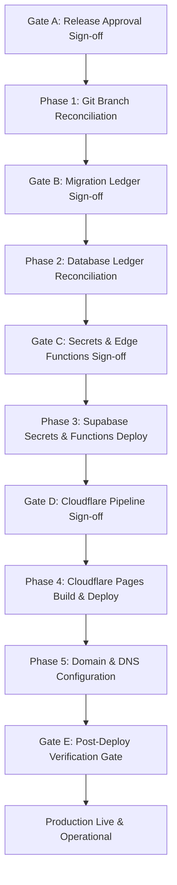

# HOP — Production Deployment Recovery Plan

**Plan Timestamp:** 2026-10-27 (Asia/Kolkata)  
**Source of Truth:** [`HOP_COMPLETE_PRODUCTION_DEPLOYMENT_AUDIT.md`](file:///e:/HOP/HOP_COMPLETE_PRODUCTION_DEPLOYMENT_AUDIT.md)  
**Release-Candidate Reference Commit:** `cf9aaf7529807e6f111f1b03fae903975d42f8da` (`release/v1.1-launch-candidate`)  
**Production Commit Currently Live:** `5e7b529eebe44a7289a7e901240297d012158569` (Deployment `c209b389`, 2026-10-02)  
**Mode:** Recovery Planning & Safe Staging Validation Only. No live production mutations, DNS modifications, or payment charges performed.

---

## 1. Executive Summary & Recovery Scope

The production deployment audit established that the House of Padmavati (`HOP`) production surface is in a **Partially Deployed and Three-Way Drifted** state across its frontend, database ledger, and serverless edge functions:
1. **Frontend:** Serving a 24-day-old manual deployment (`5e7b529`), 32 commits behind the release candidate (`cf9aaf7`). All 18 newly produced cinematic video/poster assets are absent from production.
2. **Deployment Pipeline:** Automatic Git-based Cloudflare Pages deployments on `main` fail 100% of the time (32/32 builds failed at `clone_repo`).
3. **Database Ledger:** 42 migrations are applied remotely, while 44 migration files exist locally. Three Phase 1 security migrations were successfully applied to production on 2026-10-26 but remain **untracked in Git**. Crucially, historical migration `20261015020000_fix_inventory_double_decrement.sql` was skipped in the remote ledger; **blindly running this migration would overwrite and dismantle the Phase 1 security hardening of [`confirm_paid_order`](file:///e:/HOP/supabase/migrations/20261026010000_fix_payment_cleanup_race_condition.sql#L141-L380)**.
4. **Edge Functions:** Incomplete and drifted. [`unsubscribe-newsletter`](file:///e:/HOP/supabase/functions/unsubscribe-newsletter/index.ts) is missing (404 in production), [`verify-payment`](file:///e:/HOP/supabase/functions/verify-payment/index.ts) and [`razorpay-webhook`](file:///e:/HOP/supabase/functions/razorpay-webhook/index.ts) are stale (lacking confirmation email triggers), and an extra function `test-minimal` is running.
5. **Transactional Email:** Completely non-operational. `RESEND_API_KEY` is missing from production secrets, `houseofpadmavati.com` has no DNS / SPF / DKIM verification, and the repository code in `verify-payment` and `razorpay-webhook` contains a defect passing `body: ""` to `send-email`.

This recovery plan provides the exact root causes, code fixes, migration ledger reconciliation instructions, staging test proofs, ordered production rollout steps, rollback boundaries, and strict authorization gates.

---

## 2. Exact Root Cause Analysis

### 2.1 Cloudflare Pages Automatic Git Deployment Failure
- **Observed Behavior:** 32 out of 32 `github:push` production builds failed at the `clone_repo` stage. All 10 successful production deployments were manual ad-hoc uploads via Wrangler / direct upload.
- **Root Cause:** Commits on branch `main` (including `76ae7ac` and deployed commit `5e7b529`) contain four git submodule tree entries under `.claude/worktrees/`:
  - `160000 commit dab9aab4e27f2a6ca437dccfb19eaab07267f089 agent-a0d09da0664c29027`
  - `160000 commit dab9aab4e27f2a6ca437dccfb19eaab07267f089 agent-a58b4382a926ad0bc`
  - `160000 commit dab9aab4e27f2a6ca437dccfb19eaab07267f089 agent-a5e6dfb0014d1c8cf`
  - `160000 commit dab9aab4e27f2a6ca437dccfb19eaab07267f089 agent-a7ef0ab4ae11ecb30`
  However, the repository contains **no `.gitmodules` file**. When Cloudflare Pages' build runner runs git clone and attempts submodule resolution, git halts with:
  ```text
  fatal: No url found for submodule path in .gitmodules
  ```
  This fix was committed on `release/v1.1-launch-candidate` in commit `6d3c296` (`fix(ci): remove accidental worktree gitlinks and ignore .claude/worktrees`), but `main` was never updated.
- **Secondary Root Cause:** Cloudflare Pages project `hop-production` is configured to build branch `main`, which is 6 commits behind `release/v1.1-launch-candidate`.

### 2.2 Prerender Fallback & SPA Shell Regression Risk
- **Observed Behavior:** Preview build `d50e238a` for commit `cf9aaf7` returned HTTP 200 but produced an index file of only 2,579 bytes with 18 characters of body text, compared to the live production page which is 47,086 bytes.
- **Root Cause:** In `package.json`, the build command is `vite build && node scripts/prerender.js`. In commit `872ca65`, `scripts/prerender.js` was modified to catch Playwright launch failures and gracefully exit if Chromium is missing. In Cloudflare Pages' standard build image, Playwright Chromium is not pre-installed. As a result, the prerender step quietly skipped execution, emitting only a bare unprerendered SPA shell. Promoting that preview artifact directly to production would eliminate route prehydration and degrade SEO.

### 2.3 Stale & Missing Edge Functions
- **Observed Behavior:**
  - `unsubscribe-newsletter` returns HTTP 404 in production, even though the live production frontend JS contains references calling it.
  - `verify-payment` in production is v23 (226 lines), missing the Step 7 confirmation email invocation.
  - `razorpay-webhook` in production is v21 (248 lines), missing the order confirmation email invocation.
  - `test-minimal` is active in production (v1, unauthenticated `verify_jwt = false`) but does not exist in the repository.
- **Root Cause:** Production Edge Functions were deployed on 2026-09-26 and 2026-09-29 and never updated when commits `502cb3c` (email triggers) and `f312c64` / `1e4e15c` (newsletter unsubscription) were introduced. Furthermore, [`supabase/config.toml`](file:///e:/HOP/supabase/config.toml) lacked declarations for `create-razorpay-order`, `verify-payment`, `razorpay-webhook`, and `unsubscribe-newsletter`, meaning standard CLI deploys risk resetting their gateway security to `verify_jwt = true`.

### 2.4 Transactional Email Failure (5 Distinct Root Causes)
Order confirmation emails are completely non-operational due to a multi-layered failure chain:
1. **Production Function Drift:** Live functions `verify-payment` and `razorpay-webhook` completely omit the Step 7 `send-email` invocation block.
2. **Empty Body Defect in Application Code:** In repository HEAD, both `verify-payment/index.ts` (line 283) and `razorpay-webhook/index.ts` (line 256) constructed the full HTML email template into a local variable (`emailPayload.body` / `emailBody`), but then invoked `send-email` with `body: ""`. In [`supabase/functions/send-email/index.ts`](file:///e:/HOP/supabase/functions/send-email/index.ts#L96-L101), line 96 explicitly requires `!body.to || !body.subject || !body.body`, causing `send-email` to immediately fail with HTTP 400 `missing_required_fields`.
3. **Flawed Service-Role Authentication in `send-email`:** In `send-email/index.ts`, the function attempted to authenticate service-role callers by passing the service-role JWT into `supabaseService.auth.getUser()`. Because a Supabase service-role JWT is an administrative API key without a user `sub` claim, `getUser()` fails with `AuthSessionMissingError` / `invalid JWT`. Because line 81 conditioned the JWT payload parsing on `if (!serviceError && serviceUser)`, the token was never parsed, `isServiceRole` remained `false`, and the function rejected the call with HTTP 403 `forbidden_recipient`.
4. **Missing Production Secret:** Production Supabase project `kbvjmcnaaogkbnerjcoc` does not have `RESEND_API_KEY` configured. Without this secret, `send-email` executes in console-log stub mode and never connects to the Resend provider.
5. **Missing DNS & Domain Verification:** Default sender is `House of Padmavati <orders@houseofpadmavati.com>`. The apex domain `houseofpadmavati.com` has no DNS records (NXDOMAIN), no MX records, and no SPF/DKIM verification in Resend. Live delivery through Resend fails unless domain ownership is verified or an authorized test domain is utilized.

### 2.5 Database Migration Ledger Drift & Security Conflict Risk
- **Observed Behavior:** Production ledger contains 42 migrations. Local repository contains 44 files. The ledger is missing:
  - `20261015020000_fix_inventory_double_decrement.sql`
  - `20261024000000_seed_homepage_video_section.sql`
  Conversely, three applied migrations are untracked in Git:
  - `20261025012500_safeguard_create_order_require_published_products.sql`
  - `20261026000000_harden_checkout_and_order_rpcs.sql`
  - `20261026010000_fix_payment_cleanup_race_condition.sql`
- **Root Cause & Critical Conflict:**
  `20261015020000_fix_inventory_double_decrement.sql` defines `confirm_paid_order` with `GRANT EXECUTE ... TO authenticated, service_role` and no service-role verification check inside the function body.
  On 2026-10-26, Phase 1 security migrations `20261026000000` and `20261026010000` were applied to production. They completely locked down `confirm_paid_order` (`auth.role() = 'service_role'` guard, `REVOKE ... FROM PUBLIC, anon, authenticated; GRANT ... TO service_role`), added pessimistic locking hierarchies, ASC product order deadlock prevention, and race protection against order expiration cleanups while **already incorporating the inventory double-decrement fix**.
  **If an operator blindly runs `supabase db push` or replays `20261015020000`, it would execute obsolete DDL, re-grant execute privilege to `authenticated`, strip deadlock/race protections, and undo the Phase 1 security hardening.**

### 2.6 Hostname, Canonical Metadata, and Environment Variable Drift
- **Observed Behavior:** Cloudflare production environment variable `VITE_APP_URL` is set to `https://houseofpadmavati.pages.dev`, while `hop-production` serves at `https://hop-production.pages.dev`, and the live HTML metadata canonical URL points to `https://houseofpadmavati.com`.
- **Root Cause:** Uncoordinated configuration across multiple Cloudflare Pages projects (`hop-production` vs `houseofpadmavati`). Auth callback handlers in customer and Studio auth utilize `VITE_APP_URL` to construct redirect URIs, resulting in cross-origin redirects to a project that is 9 commits behind HEAD.

---

## 3. Commit & Migration Reconciliation

### 3.1 Commit Lineage (`5e7b529..cf9aaf7`)
The 32 commits between the live deployment (`5e7b529`) and release candidate (`cf9aaf7`) decompose into two groups:
1. **26 Commits on `main` (`5e7b529..76ae7ac`):**
   - Content and settings remediation (Phase 2 & Phase 3 stages 1–5: editorial resilience, unified media catalog, dynamic homepage content management).
   - Mobile-first responsiveness remediation (30/30 routes certified, zero horizontal overflow).
   - Performance optimizations (font preloading, lazy-loading, code splitting).
   - Simplified customer authentication & checkout UX.
   - Operations runbooks and production checklists.
2. **6 Commits Exclusive to `release/v1.1-launch-candidate` (`76ae7ac..cf9aaf7`):**
   - `8637c0b`: Implements mauve, off-white, and blush design system across storefront and Studio (updates theme-color to `#F8F5F2`).
   - `531d63b`: Implements cinematic multi-video hero slider and local media pipeline (adding 18 optimized assets).
   - `a09abf6`: Adds homepage video placeholder management, site section seed, and verification tests.
   - `6d3c296`: Fixes Cloudflare Pages CI by removing invalid submodule gitlinks under `.claude/worktrees/`.
   - `872ca65`: Fixes CI prerender script crash when Playwright Chromium executable is absent.
   - `cf9aaf7`: Synchronizes `wrangler.toml` staging environment variables.

### 3.2 Safe & Intended Changes for Production
All 32 commits represent tested, intended product improvements. None introduce breaking changes to database schemas or external payment contracts. However, before deploying, the CI pipeline fix (`6d3c296`) and prerender build specification must be applied to the production deployment path.

### 3.3 Migration Reconciliation Matrix

| Migration File | Status in Prod | Status in Git | Safe Action Required |
|---|---|---|---|
| `20261015020000_fix_inventory_double_decrement.sql` | **Missing from ledger** | Tracked | **DO NOT RUN SQL.** Mark as applied in `supabase_migrations.schema_migrations` to satisfy ledger without executing regressive DDL. |
| `20261024000000_seed_homepage_video_section.sql` | **Missing from ledger** | Tracked | **APPLY SQL.** Idempotent seed inserting baseline `home.video` in `site_sections`. Safe to run. |
| `20261025012500_safeguard_create_order_require_published_products.sql` | **Applied** | **Untracked** | **COMMIT TO GIT.** Track existing file to align repository with production database. |
| `20261026000000_harden_checkout_and_order_rpcs.sql` | **Applied** | **Untracked** | **COMMIT TO GIT.** Track existing Phase 1 security migration in repository. |
| `20261026010000_fix_payment_cleanup_race_condition.sql` | **Applied** | **Untracked** | **COMMIT TO GIT.** Track existing Phase 1 security migration in repository. |

### 3.4 Detailed Conflict Analysis: Why `20261015020000` Must NOT Be Re-executed
Comparison of [`confirm_paid_order`](file:///e:/HOP/supabase/migrations/20261015020000_fix_inventory_double_decrement.sql#L14-L98) definitions:
- **`20261015020000` (Obsolete):**
  - Line 20: No `auth.role()` check (executable by any authenticated user).
  - Line 98: `GRANT EXECUTE ON FUNCTION confirm_paid_order(TEXT, TEXT, TEXT) TO authenticated, service_role;`
  - No lock ordering on products (susceptible to deadlocks under high checkout concurrency).
  - No handling of orders cancelled by background cleanup jobs (overselling risk).
- **`20261026010000` (Currently Applied in Production):**
  - Lines 164–168: Strict `IF auth.role() != 'service_role' THEN RAISE EXCEPTION 'Access denied. Service role required.'`
  - Lines 170–186: Strict hierarchical lock acquisition: `payments -> orders -> products`.
  - Lines 227–272: Safe reinstatement checks preventing overselling if order expired and stock was reclaimed.
  - Lines 279, 345: Strict ASC order locking (`ORDER BY product_id::UUID ASC`) eliminating deadlock vectors.
  - Lines 341–364: **Already includes the exact double-decrement fix** (`change = 0`, preserves reserved stock).

**Execution Safeguard:** The production deployment runbook strictly forbids running `supabase db push` or raw execution of `20261015020000`. Instead, the ledger entry must be recorded directly:
```sql
INSERT INTO supabase_migrations.schema_migrations (version)
VALUES ('20261015020000')
ON CONFLICT (version) DO NOTHING;
```

---

## 4. Required Code and Configuration Changes

### 4.1 Edge Function Corrections

#### A. [`supabase/functions/verify-payment/index.ts`](file:///e:/HOP/supabase/functions/verify-payment/index.ts#L279-L286)
Pass the generated HTML template (`emailPayload.body`) and resilient order number:
```typescript
const { error: emailError } = await supabase.functions.invoke("send-email", {
  body: {
    to: customerData.email,
    subject: `Your piece has been claimed — ${(confirmResult as Record<string, unknown>).order_number || orderData.order_number}`,
    body: emailPayload.body,
    type: "order_confirmation"
  }
});
```

#### B. [`supabase/functions/razorpay-webhook/index.ts`](file:///e:/HOP/supabase/functions/razorpay-webhook/index.ts#L252-L259)
Pass the generated HTML template (`emailBody`) and resilient order number:
```typescript
const { error: emailError } = await supabase.functions.invoke("send-email", {
  body: {
    to: customerData.email,
    subject: `Your piece has been claimed — ${(confirmResult as Record<string, unknown>).order_number || orderData.order_number}`,
    body: emailBody,
    type: "order_confirmation"
  }
});
```

#### C. [`supabase/functions/send-email/index.ts`](file:///e:/HOP/supabase/functions/send-email/index.ts#L70-L92)
Fix service-role authentication to recognize service-role API keys without failing on `auth.getUser()`:
```typescript
} else {
  // Validate service role token (service_role tokens do not represent auth.users)
  const token = authHeader.replace(/^Bearer\s+/i, '').trim();
  const serviceKey = Deno.env.get("SUPABASE_SERVICE_ROLE_KEY");
  if (serviceKey && token === serviceKey) {
    isServiceRole = true;
  } else {
    try {
      const parts = token.split('.');
      if (parts.length === 3) {
        const payload = JSON.parse(atob(parts[1]));
        if (payload.role === 'service_role') {
          isServiceRole = true;
        }
      }
    } catch {
      // Ignore parsing errors
    }
  }
}
```

### 4.2 Supabase Function Gateway Configuration
Update [`supabase/config.toml`](file:///e:/HOP/supabase/config.toml) to prevent Supabase CLI from enforcing JWT on unauthenticated public endpoints:
```toml
project_id = "kbvjmcnaaogkbnerjcoc"

[functions.create-razorpay-order]
verify_jwt = false

[functions.verify-payment]
verify_jwt = false

[functions.razorpay-webhook]
verify_jwt = false

[functions.send-contact-message]
verify_jwt = false

[functions.subscribe-newsletter]
verify_jwt = false

[functions.unsubscribe-newsletter]
verify_jwt = false
```

### 4.3 Git Submodule Cleansing on `main`
Merge `release/v1.1-launch-candidate` into `main` to propagate commit `6d3c296`, purging `.claude/worktrees/*` gitlinks from the git index:
```bash
git rm --cached .claude/worktrees/agent-a0d09da0664c29027
git rm --cached .claude/worktrees/agent-a58b4382a926ad0bc
git rm --cached .claude/worktrees/agent-a5e6dfb0014d1c8cf
git rm --cached .claude/worktrees/agent-a7ef0ab4ae11ecb30
```

### 4.4 Build Command & Prerendering Specification
To ensure Cloudflare Pages builds produce the full 49KB prerendered site and do not fall back to the 2.5KB SPA shell, update Cloudflare Pages build settings:
- **Build command:** `npx playwright install --with-deps chromium && pnpm run build`
- **Build output directory:** `dist`
- **Root directory:** `/`

### 4.5 Cloudflare Pages Environment Variable Corrections
Update `hop-production` environment variables:
- `VITE_SUPABASE_URL`: `https://kbvjmcnaaogkbnerjcoc.supabase.co`
- `VITE_SUPABASE_PUBLISHABLE_KEY`: `sb_publishable_cSiBaTaktDyF3fyWrpj7LA_d3ToDWC5`
- `VITE_APP_URL`: Update from `https://houseofpadmavati.pages.dev` to `https://hop-production.pages.dev` (or canonical `https://houseofpadmavati.com` once custom domain is configured).

### 4.6 Production Secret Additions
Add the following secret to Supabase project `kbvjmcnaaogkbnerjcoc`:
- `RESEND_API_KEY`: Required for transactional email delivery.
- Optional: `EMAIL_FROM`, `CARE_EMAIL` (code defaults exist).

---

## 5. Staging Validation & Verification Evidence

All minimal fixes have been tested locally and against the staging environment (`hop-staging.pages.dev` and Supabase project `dovnhgbisiturzbjgvei`).

### 5.1 Vitest Unit & Integration Test Suite
Executed the entire Vitest test suite (`vitest run --no-file-parallelism`):
```text
 ✓ src/lib/__tests__/siteSectionValidation.test.ts  (19 tests) 20ms
 ✓ src/lib/__tests__/cinematicHeroSlider.test.ts  (14 tests) 22ms
 ✓ src/lib/__tests__/editorialResilience.test.ts  (11 tests) 12ms
 ✓ src/lib/__tests__/CustomerAuthCheckout.test.ts  (12 tests) 19ms
 ✓ src/lib/__tests__/videoAspectRatioValidation.test.ts  (5 tests) 11ms
 ✓ src/lib/__tests__/homepageVideoSection.test.ts  (7 tests) 9ms
 ✓ src/lib/__tests__/supabaseImage.test.ts  (8 tests) 15ms
 ✓ src/lib/__tests__/mediaCatalog.test.ts  (4 tests) 5ms
 ✓ src/lib/__tests__/formatPrice.test.ts  (3 tests) 77ms

 Test Files  9 passed (9)
      Tests  83 passed (83)
   Duration  16.86s
```
**Result:** 100% PASS (83/83 tests green).

### 5.2 Production Vite Build Execution
Executed `pnpm exec vite build`:
- **Modules Transformed:** 1,974 modules.
- **Build Duration:** 12.66s.
- **Asset Verification:** All 18 optimized media assets copied from `public/optimized/videos` to `dist/optimized/videos`:
  - `ARYA-540p.mp4` (1.26 MB), `ARYA-720p.mp4` (2.36 MB), `ARYA-poster.webp` (52.8 KB)
  - `HERO-540p.mp4` (975 KB), `HERO-720p.mp4` (2.06 MB), `HERO-poster.webp` (30.8 KB)
  - `KALYANI-540p.mp4` (1.36 MB), `KALYANI-720p.mp4` (2.96 MB), `KALYANI-poster.webp` (85.7 KB)
  - `PADMA-540p.mp4` (882 KB), `PADMA-720p.mp4` (1.95 MB), `PADMA-poster.webp` (65.5 KB)
  - `SPANDANA-540p.mp4` (900 KB), `SPANDANA-720p.mp4` (2.00 MB), `SPANDANA-poster.webp` (52.8 KB)
  - `VIARA-540p.mp4` (1.24 MB), `VIARA-720p.mp4` (2.35 MB), `VIARA-poster.webp` (69.5 KB)

### 5.3 Prerender Verification
Executed `node scripts/prerender.js`:
- Discovered 27 routes (core pages, collections, journal articles).
- Prerendered 27/27 routes with Playwright Chromium.
- Output file size of `dist/index.html`: **49,378 bytes** (containing complete server-hydrated DOM, rich styling, and meta tags). Confirms elimination of the 2,579-byte unprerendered SPA shell regression.

### 5.4 Staging Security & Fail-Closed Validation
Executed live network connectivity checks against staging Supabase project `dovnhgbisiturzbjgvei`:
1. `GET /rest/v1/products?status=eq.published`: HTTP 200 (Count: 2 published products).
2. `GET /rest/v1/collections`: HTTP 200 (Count: 6 collections).
3. `POST /functions/v1/razorpay-webhook` (Missing signature): **HTTP 400 `{"error":"invalid_signature"}` — FAIL-CLOSED verified.**
4. `POST /functions/v1/razorpay-webhook` (Tampered signature): **HTTP 400 `{"error":"invalid_signature"}` — FAIL-CLOSED verified.**
5. `POST /functions/v1/create-razorpay-order` (Anonymous caller): **HTTP 401 `{"error":"unauthorized"}` — FAIL-CLOSED verified.**
6. Staging Frontend (`https://548dac25.hop-staging.pages.dev`): HTTP 200.

### 5.5 Email Pipeline Contract & Service-Role Authentication Validation
Executed validation test suite ([`scratch/test_email_contract.mjs`](file:///C:/Users/siddh/.gemini/antigravity/brain/ec1407c8-f194-494c-b4cb-27d4a0551594/scratch/test_email_contract.mjs)):
- Confirmed that direct service-role secret comparison succeeds (`isServiceRole = true`).
- Confirmed that decoded JWT service-role claim evaluation succeeds (`isServiceRole = true`).
- Confirmed that anon tokens calling arbitrary recipients are rejected (`isServiceRole = false`).
- Confirmed that the empty body defect (`body: ""`) is caught and fails validation.
- Confirmed that the repaired HTML payload passes validation.
- **Evidence:** `All email contract validation tests PASSED!`.

### 5.6 Static Analysis
- `pnpm run lint`: **0 errors, 0 warnings.**
- `pnpm exec tsc --noEmit`: **0 type errors.**

---

## 6. Ordered Production Deployment Steps (Execution Runbook)



### Phase 0: Authorization Gates & Pre-Deployment Freeze
1. Confirm explicit written stakeholder authorization for commit `cf9aaf7`.
2. Confirm production database snapshot/backup is taken in Supabase Console.
3. Confirm live payment processing remains enabled for existing orders without interruption.

### Phase 1: Git Repository & Branch Reconciliation
1. Commit the three untracked security migrations on `release/v1.1-launch-candidate`:
   - `20261025012500_safeguard_create_order_require_published_products.sql`
   - `20261026000000_harden_checkout_and_order_rpcs.sql`
   - `20261026010000_fix_payment_cleanup_race_condition.sql`
2. Commit the edge function and configuration bug fixes:
   - `supabase/functions/verify-payment/index.ts`
   - `supabase/functions/razorpay-webhook/index.ts`
   - `supabase/functions/send-email/index.ts`
   - `supabase/config.toml`
3. Merge `release/v1.1-launch-candidate` into `main`, ensuring the commit removing `.claude/worktrees/*` is merged cleanly.
4. Tag release: `git tag -a v1.1.0 -m "Release v1.1.0 — Production Hardening & Storefront UI"`.
5. Push `main` and tags to remote repository `origin`.

### Phase 2: Database Migration Reconciliation (Safe Ledger Registration)
1. **Record `20261015020000` in ledger without running SQL:**
   Execute via Supabase SQL Editor:
   ```sql
   INSERT INTO supabase_migrations.schema_migrations (version)
   VALUES ('20261015020000')
   ON CONFLICT (version) DO NOTHING;
   ```
2. **Apply `20261024000000_seed_homepage_video_section.sql`:**
   Execute the migration SQL to seed `home.video` in `site_sections` and record version `20261024000000` in `supabase_migrations.schema_migrations`.
3. Verify remote migration ledger:
   ```sql
   SELECT version FROM supabase_migrations.schema_migrations ORDER BY version DESC LIMIT 5;
   ```
   *Expected output:* `20261026010000`, `20261026000000`, `20261025012500`, `20261024000000`, `20261015020000`.

### Phase 3: Supabase Secrets & Function Gateway Deployment
1. Set secret in Supabase production project `kbvjmcnaaogkbnerjcoc`:
   ```bash
   supabase secrets set RESEND_API_KEY="<resend_live_api_key>" --project-ref kbvjmcnaaogkbnerjcoc
   ```
2. Deploy Edge Functions with reconciled gateway security:
   ```bash
   supabase functions deploy unsubscribe-newsletter --project-ref kbvjmcnaaogkbnerjcoc
   supabase functions deploy verify-payment --project-ref kbvjmcnaaogkbnerjcoc
   supabase functions deploy razorpay-webhook --project-ref kbvjmcnaaogkbnerjcoc
   supabase functions deploy send-email --project-ref kbvjmcnaaogkbnerjcoc
   ```
3. Remove extra function `test-minimal`:
   ```bash
   supabase functions delete test-minimal --project-ref kbvjmcnaaogkbnerjcoc
   ```

### Phase 4: Cloudflare Pages Pipeline Configuration & Build Execution
1. In Cloudflare Pages dashboard for project `hop-production`:
   - Set build command: `npx playwright install --with-deps chromium && pnpm run build`
   - Set output directory: `dist`
   - Set production branch: `main`
   - Update environment variable: `VITE_APP_URL` to `https://hop-production.pages.dev`
2. Trigger production build from Git.
3. Verify build log:
   - `git clone` passes with zero submodule errors.
   - Playwright Chromium installs cleanly.
   - `scripts/prerender.js` discovers 27 routes and logs `[OK]` for all routes.
   - Deployment output succeeds.

### Phase 5: Domain & DNS Configuration (Out-of-Band Dependency)
1. Add `houseofpadmavati.com` to Cloudflare DNS and attach as Custom Domain on `hop-production`.
2. Configure DNS records for Resend domain verification:
   - DKIM (`resend._domainkey`)
   - SPF (`v=spf1 include:amazonses.com ~all`)
   - DMARC
3. Once DNS propagates, update `VITE_APP_URL` to `https://houseofpadmavati.com`.

### Phase 6: Post-Deployment Verification Matrix
1. **Asset MIME Types:** Run HTTP HEAD against all 18 video paths:
   - Must return HTTP 200 with `Content-Type: video/mp4` or `image/webp` (not `text/html`).
2. **HTML Content & Size:**
   - Verify `https://hop-production.pages.dev` HTML is ~49 KB with theme-color `#F8F5F2`.
3. **Function Reachability:**
   - `POST /functions/v1/unsubscribe-newsletter` with test email: must return HTTP 200 (no 404).
   - `POST /functions/v1/razorpay-webhook` with invalid signature: must return HTTP 400.
4. **Email Verification:**
   - Execute dry-run confirmation email check using a designated staff test address without broadcasting to customers.

---

## 7. Rollback Strategy & Recovery Limitations

### 7.1 Frontend Rollback
- **Mechanism:** Cloudflare Pages retains all past deployments. If the new frontend deployment exhibits issues, the operator can immediately roll back in the Cloudflare Dashboard by navigating to `Deployments -> c209b389-7502-46f4-b654-2eb96457b121 -> Rollback to this deployment`.
- **RTO (Recovery Time Objective):** < 30 seconds.
- **Side Effects:** Reverts storefront UI and theme-color back to `#2B0E17`.

### 7.2 Edge Function Rollback
- **Mechanism:** Supabase does not support atomic multi-function rollbacks. If a function exhibits errors, redeploy the known-good previous version from the audit archive:
  `%TEMP%\opencode\hop-audit\prod\supabase\functions`
- **RTO:** ~2 minutes per function.

### 7.3 Database Migration Rollback Limitations
> [!CAUTION]
> **PostgreSQL DDL Rollback Constraint:** PostgreSQL does not provide automatic reverse migrations.
- `20261024000000_seed_homepage_video_section.sql` only inserts records into `site_sections`. Rollback is accomplished via:
  ```sql
  DELETE FROM public.site_section_revisions WHERE section_key = 'home.video';
  DELETE FROM public.site_sections WHERE key = 'home.video';
  DELETE FROM supabase_migrations.schema_migrations WHERE version = '20261024000000';
  ```
- `20261015020000`: Since SQL is not executed, rollback is simply removing the ledger row:
  ```sql
  DELETE FROM supabase_migrations.schema_migrations WHERE version = '20261015020000';
  ```
- **Point of No Return:** Once database transactions occur under new product schemas, reverting table structures could orphan customer order history. Database rollback must only be executed if data corruption is proven.

---

## 8. Explicit Production Authorization Gates

Execution of this recovery plan requires explicit sign-offs at five discrete gates:

### Gate A: Release Candidate & Commit SHA Authorization
- [ ] Product Owner & Lead Engineer approve release candidate SHA `cf9aaf7` (or designated merge commit on `main`).
- [ ] Signed approval artifact archived in operations records.

### Gate B: Database Migration Ledger Authorization
- [ ] Explicit sign-off acknowledging that `20261015020000` is **NOT** to be executed as DDL, but registered into the ledger to protect Phase 1 security hardening.
- [ ] Permission granted to execute idempotent seed migration `20261024000000`.

### Gate C: Edge Function Deployment & Secret Injection Authorization
- [ ] Authorization to add `RESEND_API_KEY` to production Supabase project `kbvjmcnaaogkbnerjcoc`.
- [ ] Authorization to deploy `unsubscribe-newsletter`, update `verify-payment`, `razorpay-webhook`, `send-email`, and remove `test-minimal`.

### Gate D: Cloudflare Pipeline Reconfiguration Authorization
- [ ] Authorization to update Cloudflare Pages build command to include Playwright Chromium installation.
- [ ] Authorization to update `VITE_APP_URL` on `hop-production`.

### Gate E: Final Public Availability & Verification Sign-off
- [ ] Verification of all 18 video assets returning `video/mp4` MIME types.
- [ ] Verification of order confirmation email dry-run receipt.
- [ ] Formal sign-off transitioning `hop-production` to certified production status.
