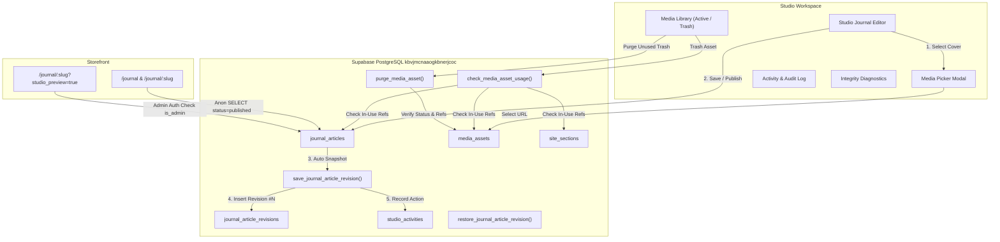

# House of Padmavati — Phase 3, Stage 5: Editorial Architecture & Operational Resilience

**Document ID:** `HOP-ARCH-P3-S5-001`  
**Date:** 2026-10-13  
**Author:** Principal Software Architect, Editorial CMS Architect, Database Reliability Engineer & Production Release Lead  
**Scope:** Phase 3 — Stage 5: Editorial Management & Operational Resilience  
**Target Repository:** `HOP-github` (`main`)  
**Production Supabase:** `kbvjmcnaaogkbnerjcoc`  
**Production URL:** `https://houseofpadmavati.pages.dev`  

---

## 1. Architectural Vision & Scope

Stage 5 completes the editorial and operational foundation of House of Padmavati. It transitions editorial content management (Journal reflections) and media governance from isolated administrative tools into an integrated, fault-tolerant editorial system.

The architecture addresses three core workstreams:
1. **Workstream A — Editorial Content Management:** Complete owner lifecycle for Journal reflections (`public.journal_articles`) with author attribution, accessibility metadata, curation ordering, Media Library integration, authenticated draft previews, and immutable revision histories (`public.journal_article_revisions`).
2. **Workstream B — Unified Media Governance & Defensive Protection:** Two-phase deletion (Trash lifecycle), one-click asset restoration, multi-entity reference detection, and safe permanent purging.
3. **Workstream C — Operational Resilience & Auditability:** Filterable, paginated audit logging (`public.studio_activities`), automated system integrity diagnostics, and an actionable disaster recovery protocol.



---

## 2. Workstream A — Journal & Editorial Data Architecture

### 2.1 Database Schema Extensions

Migration `20261012020000_phase3_stage5_editorial_and_resilience.sql` extended `public.journal_articles` with forward-compatible columns:

```sql
ALTER TABLE public.journal_articles
  ADD COLUMN IF NOT EXISTS author TEXT NOT NULL DEFAULT 'House of Padmavati',
  ADD COLUMN IF NOT EXISTS image_alt TEXT,
  ADD COLUMN IF NOT EXISTS sort_order INTEGER NOT NULL DEFAULT 0,
  ADD COLUMN IF NOT EXISTS archived_at TIMESTAMPTZ;

CREATE INDEX IF NOT EXISTS idx_journal_articles_curated_order
  ON public.journal_articles (sort_order ASC, published_at DESC);
```

### 2.2 Immutable Journal Revisions

Revision history is recorded in `public.journal_article_revisions`:

```sql
CREATE TABLE IF NOT EXISTS public.journal_article_revisions (
  id              UUID PRIMARY KEY DEFAULT gen_random_uuid(),
  article_id      UUID NOT NULL REFERENCES public.journal_articles(id) ON DELETE CASCADE,
  revision_number INTEGER NOT NULL,
  title           TEXT NOT NULL,
  slug            TEXT NOT NULL,
  tag             TEXT NOT NULL,
  img             TEXT NOT NULL,
  asset_path      TEXT,
  dek             TEXT NOT NULL,
  content         TEXT,
  author          TEXT NOT NULL DEFAULT 'House of Padmavati',
  image_alt       TEXT,
  status          TEXT NOT NULL,
  snapshot        JSONB NOT NULL,
  change_summary  TEXT,
  created_by      UUID REFERENCES auth.users(id),
  actor_email     TEXT,
  created_at      TIMESTAMPTZ NOT NULL DEFAULT now(),
  CONSTRAINT unq_journal_article_revision UNIQUE (article_id, revision_number)
);
```

### 2.3 Row-Level Security & Zero-Trust Access

1. **Anonymous / Customer Visitors:**
   - Direct `SELECT` on `public.journal_articles` is restricted by RLS policy `journal_articles_public_read`:
     `USING (status = 'published')`
   - Direct `SELECT` on `public.journal_article_revisions` is blocked by RLS (`journal_revisions_admin_all` requires `public.is_admin()`). Unauthenticated REST requests receive `[]` (0 rows leaked).
2. **Authenticated Administrators:**
   - Full CRUD on articles and revision histories via `public.is_admin()` policy evaluation.
   - Administrative mutations occur through security-definer RPCs: `save_journal_article_revision`, `restore_journal_article_revision`, `archive_journal_article`, and `restore_journal_article`.

### 2.4 Live Draft Preview Architecture

To allow editorial review of drafts before publication without leaking unapproved content:
- Storefront routes (`/journal/:slug`) inspect `window.location.search` for `studio_preview=true`.
- The `useJournalArticle` hook queries Supabase auth session:
  - If a valid administrative session exists (`public.is_admin()`), the draft article row is retrieved and displayed with an amber alert banner: `Studio Draft Preview: Viewing an unapproved reflection as an authenticated administrator.`
  - If the caller is anonymous or a regular customer, the preview parameter is safely ignored, and only published articles are served. Draft articles return HTTP 404 / "This entry is not on the shelf."

---

## 3. Workstream B — Unified Media Governance & Defensive Protection

### 3.1 Two-Phase Asset Deletion Lifecycle

To prevent accidental media loss, deletion is structured into two defensive stages:
1. **Phase 1 — Move to Trash (Soft Deletion):**
   - Media is marked with `status = 'trash'` and `deleted_at = now()`.
   - Asset remains cataloged in the database and underlying storage file is preserved.
   - Can be restored to the active catalog with one click.
2. **Phase 2 — Permanent Purge:**
   - Only assets currently in `trash` can be targeted.
   - Execution requires passing the upgraded `check_media_asset_usage` check. If any active reference is detected anywhere across the store, the database aborts the purge and returns the list of referencing entities.
   - When 0 references exist, `purge_media_asset` deletes the database row and triggers storage file removal.

### 3.2 Reference Inspection Graph

The upgraded `public.check_media_asset_usage(p_url TEXT)` inspects all content domains:
1. `public.product_images` (`url = p_url`) -> Product primary and gallery images.
2. `public.collections` (`hero_video_url = p_url OR hero_image_url = p_url`) -> Collection hero films and posters.
3. `public.journal_articles` (`img = p_url OR asset_path = p_url OR content LIKE '%' || p_url || '%'`) -> Cover imagery, asset manifests, and markdown body embeds.
4. `public.settings` (`homepage_cinematic_video`) -> Homepage video and poster stills.
5. `public.site_sections` (`draft_payload LIKE '%' || p_url || '%' OR published_payload LIKE '%' || p_url || '%'`) -> Homepage, About, Customer Care, and Policy document payloads.

---

## 4. Workstream C — Operational Resilience & Integrity

### 4.1 Authoritative Activity & Audit Log

`public.studio_activities` captures administrative operations:
- Supported entity types: `journal`, `media`, `site_section`, `product`, `collection`, `settings`, `disaster_recovery`.
- Captures actor email, ISO timestamp, entity UUID, action description, and structured JSONB payload diff.
- Studio UI (`/studio/activity`) provides category filtering, real-time log refresh, pagination, and expandable audit snapshots.

### 4.2 Automated System Integrity Diagnostics

The `diagnosticsService` evaluates 5 critical architectural pillars:
1. **Site Sections Inventory:** Verifies that all 11 canonical sections are cataloged and have non-null, valid JSON payloads.
2. **Journal Content Health:** Ensures all articles have valid slugs, titles, and reachable cover images.
3. **Media Catalog Consistency:** Checks active vs. trashed asset records.
4. **Storage Bucket Accessibility:** Verifies that `product-images` and `HOP-films` buckets respond to listing requests.
5. **Security Policy Containment:** Ensures anonymous access is strictly blocked from internal tables.

---

## 5. Architectural Quality Attributes

| Attribute | Architectural Guarantee | Verification Method |
|---|---|---|
| **Confidentiality** | Zero draft leakage to public visitors | Playwright automated tests verify REST queries for draft/archived return 0 rows. |
| **Auditability** | Tamper-resistant immutable revision tracking | Database constraints enforce sequential revisions; updates write immutable snapshots. |
| **Availability** | Seamless fallback to grounded source code | Vitest and Playwright verify graceful degradation when database records are absent. |
| **Integrity** | In-use media assets cannot be deleted | RPC triggers check references across 5 entities before permitting purge. |
| **Maintainability** | Clean separation of concerns | Studio UI decoupled from storefront rendering; reusable `MediaPickerModal`. |
